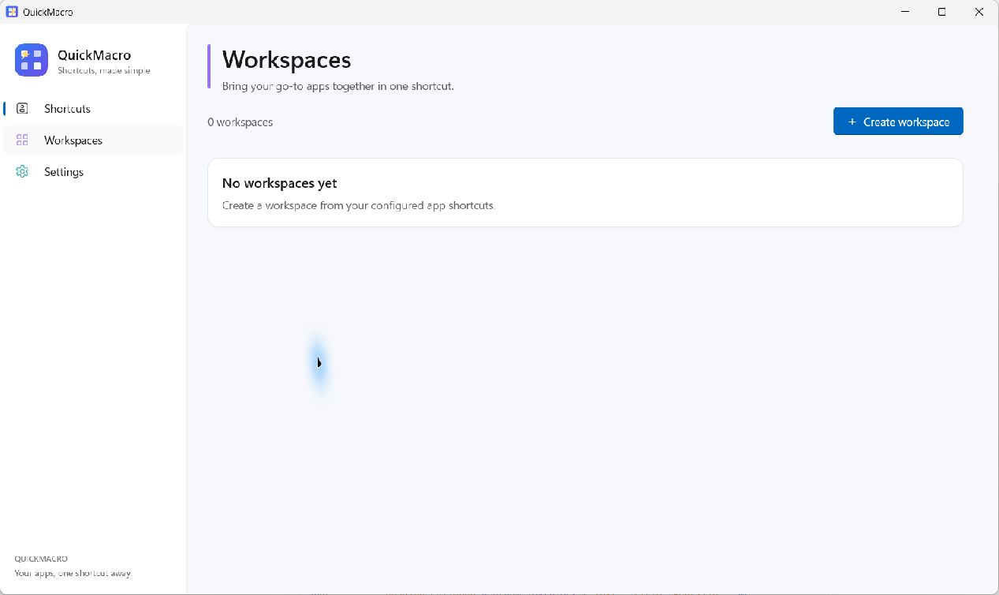
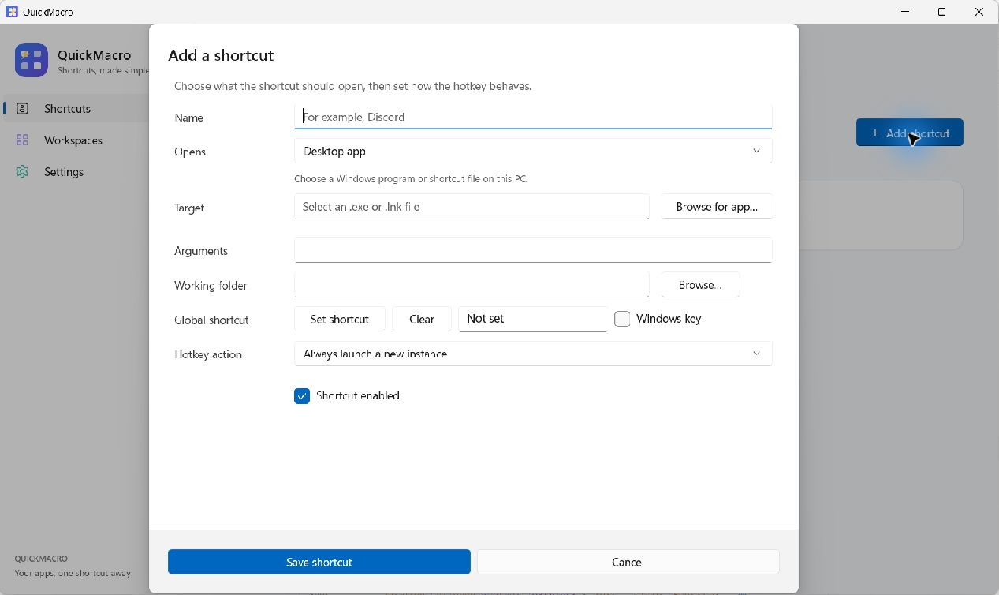

# QuickMacro for Windows

The WinUI 3 app is the primary QuickMacro app. It uses a custom QuickMacro icon and is published as `QuickMacro.exe`. The previous WinForms version remains available as `QuickMacro.Legacy.exe` for fallback and comparison.

Both versions share `%LOCALAPPDATA%\QuickMacro\config.json`. Avoid running both versions while editing settings so they do not overwrite each other's changes.

## Run from source

Install the .NET 8 SDK and ensure the Windows App SDK NuGet packages can be restored. Visual Studio is optional. From the repository root:

```powershell
dotnet restore .\src\QuickMacro.WinUI\QuickMacro.WinUI.csproj
dotnet run --project .\src\QuickMacro.WinUI\QuickMacro.WinUI.csproj
```

## Publish a self-contained x64 build

```powershell
dotnet publish .\src\QuickMacro.WinUI\QuickMacro.WinUI.csproj -c Release -r win-x64 --self-contained true
```

Open `src\QuickMacro.WinUI\bin\Release\net8.0-windows10.0.19041.0\win-x64\publish\QuickMacro.exe`. Keep the entire `publish` folder together when moving or sharing the app.

The app reuses QuickMacro's existing shortcut, app discovery, startup, backup, tray, and workspace-placement services. The workspace editor lets you select configured or installed apps and arrange their windows in an interactive drag-and-resize desktop preview.

## Screenshots

### Shortcuts



### Add a shortcut



### Workspaces


See [CHANGELOG.md](CHANGELOG.md) for release notes.
